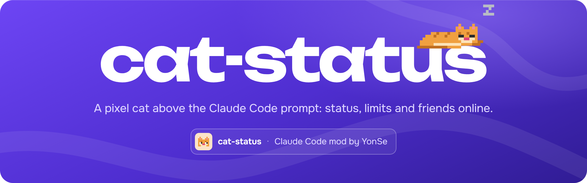
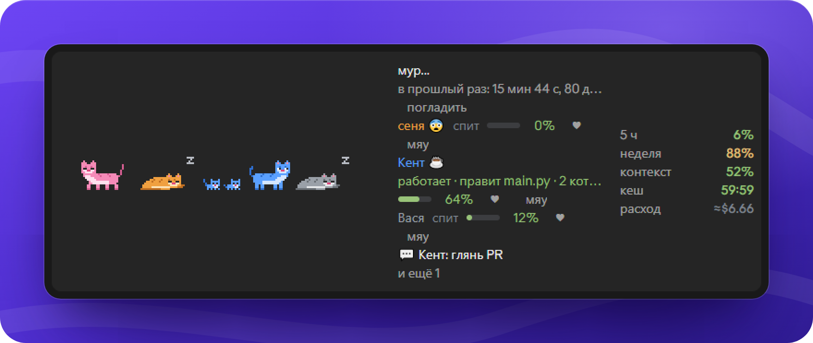
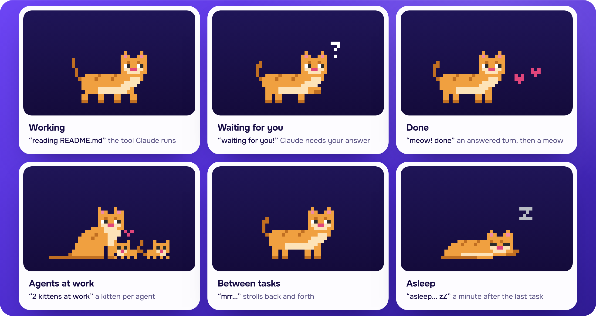

<p align="center">
  
</p>

A pixel cat that lives above the Claude Code prompt. It shows what Claude is doing right now, your plan limits, the context window, the prompt cache and what the session costs. Put friends in the same room and their cats share the yard: they run, nap, meow and can be petted. Every agent Claude starts brings the cat a kitten until its work is done.

It works in the terminal and in the desktop app, and speaks English or Russian: `/cat lang en` or `/cat lang ru` switches it. A new cat starts in Russian when the system locale Claude Code reports is Russian and in English otherwise; a cat from an earlier version keeps Russian.

<p align="center">
  
</p>
<p align="center"><sub>A real screenshot from the Claude Code desktop app, with the demo friends of <code>/cat preview</code> in the room.</sub></p>

## What the band shows

- **The cat and its line.** What Claude is doing in a few words (`reading README.md`, `running npm test`, `searching "TODO"`), how long the task runs and how many actions it took. Under it, a pet button.
- **Limits.** The 5-hour and weekly limits (and a spend limit, when your plan has one) with the time left until each resets. A toast warns at 90%.
- **Context**, filled against the auto-compact window the way Claude Code's own meter fills, for example 500k on a 1M model with `autoCompactWindow: 500000`.
- **Prompt cache**: a countdown to when it goes cold, 60 minutes by default or 5 with `/cat cache 5`. For the 60-minute cache a toast comes three minutes before.
- **Cost** of the session. On a subscription it reads `≈$` and means the API price of the same work, not a bill.
- **Friends**: up to three under the caption, each with their status and 5-hour limit. In the desktop app they come with buttons to pet, meow or react with 👍 🔥 😹 to a finished task.
- **Lifetime stats** in `/cat`: tasks closed, actions, errors survived, the longest task, kittens raised.

<p align="center">
  
</p>
<p align="center"><sub>The sprites and captions above come out of the mod itself, rendered through <code>claude plugin test</code>.</sub></p>

## Install

You need Claude Code 2.1.287 or later: the mod uses `$.agent.list`, the `agent.spawn` event and `classic.SubagentStart`, and older builds refuse to load it.

1. Clone the repository into your mods folder:

   ```bash
   git clone https://github.com/YonSeTeam/cat-status.git ~/.claude/mods/cat-status
   ```

2. Add three keys to the `env` block of `~/.claude/settings.json`, keeping everything else in the file as it is:

   ```json
   "env": {
     "CLAUDE_CODE_PLUGIN_DIRS": "/home/you/.claude/mods/cat-status",
     "CLAUDE_CODE_ENABLE_FUNCTION_HOOKS": "1",
     "CLAUDE_CODE_PLUGIN_DIR_WATCH": "1"
   }
   ```

   Use the absolute path of the folder (`C:\\Users\\you\\.claude\\mods\\cat-status` on Windows). If `CLAUDE_CODE_PLUGIN_DIRS` already lists other folders, append this one with `;` on Windows or `:` elsewhere.

3. Open a new session. The cat appears above the prompt, and `/cat` lists everything it can do.

With `CLAUDE_CODE_PLUGIN_DIR_WATCH` on, a `git pull` updates the cat without a restart. Without it, Claude Code reads the mod once per session.

You can also hand the steps to Claude Code itself: *"Install the cat-status mod from https://github.com/YonSeTeam/cat-status as its README describes."*

## Commands

`/cat` with no arguments prints the lifetime stats and the full list. On builds that take non-Latin command names, `/кот` works too.

| Command | What it does |
| --- | --- |
| `/cat stats` | lifetime stats |
| `/cat compact` · `/cat full` | one line, or the full band |
| `/cat hide` · `/cat show` | hide the cat, bring it back |
| `/cat cache 5` · `/cat cache 60` | how long the prompt cache lives |
| `/cat lang en` · `/cat lang ru` | the cat's language |
| `/cat server <url>` | your friends server |
| `/cat friend new` · `/cat friend <code>` | open a room, or join one by its code |
| `/cat name <name>` · `/cat color <color>` | how friends see you: orange, gray, black, white, blue, pink, green |
| `/cat share on` · `/cat share off` | show friends what Claude is doing (off by default) |
| `/cat notify on` · `/cat notify off` | toasts when a friend comes and goes |
| `/cat who` | who is in the room, their tasks today and limits |
| `/cat invite` | a ready message for a friend: how to install the cat and join |
| `/cat meow [name\|all]` | your friend's cat jumps with a «!» |
| `/cat say <name\|all> <text>` | a note over their cat for a minute |
| `/cat mood <emoji\|off>` | a badge over your cat |
| `/cat preview` | demo friends for 30 seconds |
| `/cat solo` | leave the room |

## Friends online

No server ships with the mod, and until you set one the cat makes no network requests at all. To see friends, run the presence server from [`server/`](server/): plain Node, no dependencies, rooms kept in memory.

```bash
docker build -t cat-sync server
docker run -d --name cat-sync --restart unless-stopped -p 9797:9797 -v "$PWD/server/public:/app/public:ro" cat-sync
```

Then, in Claude Code:

```text
/cat server http://your-host:9797
/cat friend new
/cat invite
```

`/cat invite` writes the message to send: your friend's Claude Code reads `<server>/install`, downloads the mod from `<server>/cat-status.zip` and sets it up, then your friend types `/cat server` and `/cat friend` with your room code. Pack that archive into the folder the server serves:

```bash
python scripts/pack-zip.py server/public/cat-status.zip
```

The server speaks plain HTTP. Put it behind a reverse proxy with TLS and start it with `-e PUBLIC_URL=https://cats.example.com`, so `/install` names the address your friends actually reach.

`scripts/` has the deploy, packing and type-check helpers. They read the host from `CAT_SERVER` and the rest from the variables listed in [`scripts/env.sh`](scripts/env.sh).

## What leaves your machine

- **Without `/cat server`:** nothing. Limits, context and cost come from Claude Code locally.
- **In a room**, every 8 seconds and whenever the cat's status changes: the room code, a random id for this machine, a short session key, your cat's name, color and mood badge, its status (working, waiting, done, resting), how many tasks you closed today, your 5-hour limit and when it resets, and how many agents are at work.
- **With `/cat share on`** also a short activity line: file names, program names and tool names, never the arguments of a command or the text of a search.
- **When you pet, meow, react or leave a note**, that goes to the server too, addressed to your friend, with the note's text.
- **The server** keeps rooms in memory and forgets a silent session after 10 minutes. The room code is the only key: anyone who has it can join.

## Development

The repository root is the mod itself: `hooks/register.tsx` is the whole mod, `types/index.d.ts` declares its state, `tests/` runs inside the engine.

```bash
claude plugin validate .
claude plugin test .
```

How the mod is built, the engine rules that have bitten before and the server's endpoints are in [`docs/development.md`](docs/development.md) (in Russian).

## License

[GNU AGPL-3.0](LICENSE). You can use, change and share the mod and the server. If you share a changed version, or run a changed server for other people, its source has to be open under the same license.

<p align="center"><sub>Made by YonSe</sub></p>
